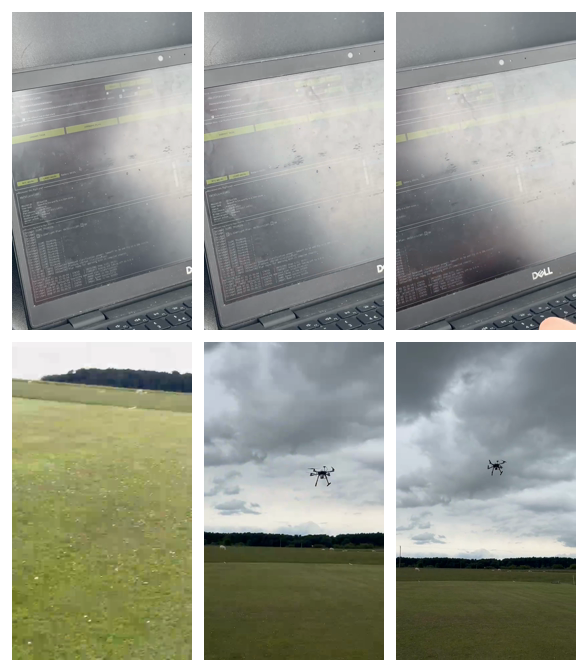

# Clip B: local inspection

Window [18, 23) s, 10 Hz, 50 decoded samples at 180 px width.

5 samples fall below the frozen full-clip cutoff (103.131); minimum sharpness is 60.338.
Maximum mean luma: 167.775.

Left to right, top to bottom: 18 s, 18.9 s, 19.9 s, 20.9 s, 21.9 s, 22.9 s.

The cutoff comes from the original 1 Hz full-clip audit; it is not refitted to this short window. Low-sharpness counts describe sampled frames, not independently detected defect events. Timestamps are the fps-filter output grid, not original camera timestamps.

Temporal luma differences here span 0.1 s (first sample has no predecessor); they must not be compared directly with the 1 s differences in the original audit. Sharpness remains a texture- and scale-dependent proxy, not a blur diagnosis.

Run `python -m videoaudit.review`. Source hashes, the frozen reference hash and exact sample times are in `summary.json` and `frame_metrics.csv`.
